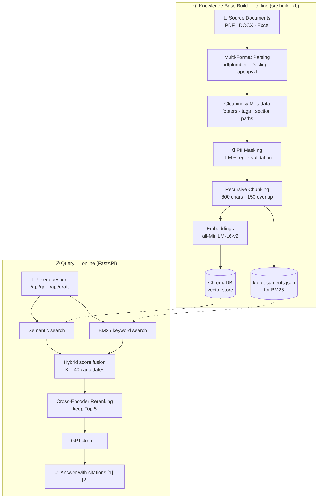

# RFP Intelligence System

<p align="center">
  
  
  
  
  
  
  
  <br>
  
  
  
  
  
  
  
</p>

## Overview

The RFP Intelligence System is a Retrieval-Augmented Generation (RAG) platform designed to help proposal teams search organizational knowledge, retrieve supporting evidence, and generate grounded RFP responses.

The system uses BeamData knowledge assets, proposal documents, tender documents, and past project information as its knowledge base.

---

## System Architecture



---

## Project Structure

```text
rfp-intelligence/
├── _source_data/
├── data/
│   ├── chroma_db/
│   ├── eval_runs/
│   └── evaluation outputs
├── data_langchain/
│   ├── kb_documents.json
│   └── build_log_v2.txt
├── frontend/
│   └── index.html
├── src/
│   ├── api.py
│   ├── build_kb.py
│   ├── config.py
│   ├── chains/
│   ├── retrievers/
│   ├── prompts/
│   └── evaluation/
├── start_server.bat
└── stop_server.bat
```

---

## Source Data

Main source collections:

- BeamData and WeCloudData company knowledge
- Past project documents
- Proposal documents
- Tender and procurement documents
- Capability and marketing materials

---

## Configuration

Settings live in `src/config.py`. The OpenAI key and model settings are read from `.env`.

```python
CHUNK_SIZE = 800
CHUNK_OVERLAP = 150

EMBEDDING_MODEL = "sentence-transformers/all-MiniLM-L6-v2"

RETRIEVER_K = 40      # candidates retrieved before reranking
RERANK_TOP_N = 5      # chunks kept after reranking

LLM_MODEL = "gpt-4o-mini"
LLM_TEMPERATURE = 0.1
```

`RETRIEVER_K = 40` and `RERANK_TOP_N = 5` were chosen from the reranker experiments in the [Results](#results) section.

---

## Knowledge Base Construction

### PDF Pipeline
- pdfplumber
- Page-aware extraction
- Citation support

### DOCX Pipeline
- Docling (DocumentConverter)
- Section-aware parsing
- Proposal structure preservation

### Excel Pipeline
- openpyxl
- Tender requirement extraction
- Table-aware processing

### PII Masking

Confidential proposal documents are masked before they are chunked and indexed, in two steps:

1. **LLM masking:** GPT-4o-mini replaces sensitive values with placeholders such as `[PERSON_NAME]`, `[CLIENT_NAME]`, `[ADDRESS]`, `[ID]` and `[POSTAL_CODE]`. A whitelist keeps known organization names (for example BeamData and WeCloudData) unchanged.
2. **Regex validation:** a second pass catches any remaining emails, phone numbers and URLs and replaces them with `[EMAIL]`, `[PHONE]` and `[URL]`.

### Parallel Processing

Documents are processed concurrently to reduce indexing time:

- `ProcessPoolExecutor` for CPU-bound PDF parsing
- `ThreadPoolExecutor` for Excel files and for per-section LLM masking of DOCX files

---

## Chunking Strategy

The project uses RecursiveCharacterTextSplitter with:

- Chunk Size: 800
- Chunk Overlap: 150
- Metadata preservation
- Duplicate chunk removal
- Section-aware chunking

---

## Retrieval Methods

### Semantic Retrieval
Vector similarity search using ChromaDB.

### Hybrid Retrieval
Semantic retrieval + BM25 keyword search.

### Reranked Retrieval
Hybrid retrieval followed by Cross-Encoder reranking.

Reranker model:

```text
cross-encoder/ms-marco-MiniLM-L-6-v2
```

---

## Evaluation

The project uses a ground-truth evaluation framework based on:

- RAGAS
- LLM-as-a-Judge
- Ground-truth answers
- Ground-truth contexts

### Metrics

Retrieval:
- Context Precision
- Context Recall

Generation:
- Faithfulness
- Answer Relevancy
- Semantic Similarity

Citation:
- Citation Accuracy

---

## Results

### 1. Comparison of Retrieval Approaches

Source: `data/rag_eval_final_summary.csv` (38 ground-truth questions)

| Setup | Context Precision | Context Recall | Faithfulness | Answer Relevancy | Semantic Similarity | Citation Accuracy |
|---|---|---|---|---|---|---|
| No RAG | 0.00 | 0.00 | 0.06 | 0.66 | 0.67 | — |
| Semantic | 0.34 | 0.71 | 0.88 | 0.91 | 0.75 | 0.96 |
| Hybrid | 0.49 | 0.76 | 0.86 | 0.91 | 0.75 | 0.94 |
| Reranked | 0.53 | 0.59 | 0.82 | 0.85 | 0.73 | 0.98 |

### 2. Reranker Tuning

Source: `data/eval_runs/` (K = candidates retrieved, Top = chunks kept after reranking)

| Config | Context Precision | Context Recall | Faithfulness | Answer Relevancy | Citation Accuracy | Latency (s) |
|---|---|---|---|---|---|---|
| K20 / Top3 | 0.51 | 0.52 | 0.80 | 0.81 | 0.99 | 3.9 |
| K30 / Top3 | 0.54 | 0.58 | 0.81 | 0.83 | 0.91 | 3.9 |
| K30 / Top5 | 0.53 | 0.62 | 0.82 | 0.93 | 0.99 | 4.8 |
| K30 / Top7 | 0.55 | 0.62 | 0.82 | 0.88 | 0.96 | 5.1 |
| K40 / Top3 | 0.55 | 0.62 | 0.79 | 0.83 | 0.99 | 4.8 |
| **K40 / Top5 (final)** | **0.58** | **0.71** | **0.85** | **0.94** | **1.00** | 5.6 |
| K50 / Top3 | 0.57 | 0.57 | 0.79 | 0.83 | 0.97 | 4.5 |

K40 / Top5 gave the best scores on almost every metric, at the cost of about 1.7 s more latency than K20 / Top3.

Each experiment in `data/eval_runs/` has three files: `_summary.csv` (averages), `_full.csv` (per question) and `_by_category.csv` (per question category).

---

## Setup

```bash
git clone https://github.com/RahafAlrehaili/rfp-intelligence.git
cd rfp-intelligence

python -m venv .venv
.venv\Scripts\activate        # Windows
# source .venv/bin/activate   # macOS / Linux

pip install -r requirements.txt

copy .env.example .env        # Windows
# cp .env.example .env        # macOS / Linux
```

Then open `.env` and set `OPENAI_API_KEY`.

---

## Build the Knowledge Base

Add documents to `_source_data/`, then run:

```bash
py -m src.build_kb            # build or update the knowledge base
py -m src.build_kb --reset    # delete the existing vector database and rebuild from scratch
py -m src.build_kb --no-index # only write kb_documents.json, do not build ChromaDB
```

---

## Run the API

```bash
uvicorn src.api:app --reload
```

Or on Windows, run `start_server.bat` to start the server in a separate window, and `stop_server.bat` to stop it.

Default URL:

```text
http://127.0.0.1:8000
```

The web interface is served at `/`.

### API Endpoints

| Method | Endpoint | Description |
|---|---|---|
| GET | `/api/health` | Health check and current model settings |
| POST | `/api/qa` | Answer a question with cited sources. Body: `{"question": "..."}` |
| POST | `/api/draft` | Draft an RFP section from the knowledge base. Body: `{"section_prompt": "...", "extra_instructions": "..."}` |
| POST | `/api/similar` | Return the most similar chunks. Body: `{"query": "...", "top_k": 8, "doc_type": null}` |
| POST | `/api/reload` | Clear the cached chains so changes are picked up |

---

## Run Evaluation

```bash
py -m src.evaluation.evaluate_reranker --retriever-k 40 --rerank-top-n 5
```

Results are saved to `data/eval_runs/`.

---

## Recommended Workflow

1. Add documents to `_source_data/`
2. Build the knowledge base
3. Run the API
4. Test QA and proposal drafting
5. Run evaluation
6. Review evaluation results

---

## Key Findings

- Hybrid retrieval improved retrieval coverage.
- Reranking improved retrieval precision and citation accuracy.
- Retrieval quality had a larger impact on answer quality than prompt engineering.
